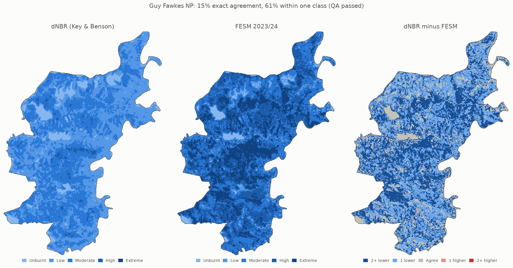

# FESM Agreement Checker

An independent QA check of NSW Fire Extent and Severity Mapping (FESM) for one fire. It builds a burn-severity map from Sentinel-2 imagery with a standard, transparent method (dNBR), compares it pixel by pixel with FESM, gates the result on input quality, and records exactly what went in.

**Result for Guy Fawkes NP (Dec 2023):** dNBR and FESM agree on *where* the fire burned and on the *order* of severity, but standard dNBR thresholds put the severity **one to two classes lower** than FESM almost everywhere: 15% exact agreement, 61% within one class, dNBR lower on 85% of pixels. All six QA gates passed.



## How it works

```
 NPWS fire outline ──ogr2ogr──▶ outline.gpkg ──┐
 Sentinel-2 pre/post: NIR, SWIR2, fmask ──┐    │  gdalwarp: EPSG:3308, 20 m, -tap,
 FESM 2023/24 (classes 0–5) ──────────────┴────┴─ clipped to the outline
                                                   ▼
                                     8 grids, identical size and pixels
                                                   ▼
          QA gates → NBR → dNBR → severity classes → compare with FESM
                                                   ▼
          dnbr.tif · severity.tif · confusion.csv · map.png · metadata.json
```

1. **Prepare** (`scripts/prepare.sh`, GDAL): `ogr2ogr` cuts the fire's polygon out of the NPWS Fire History. `gdalwarp` reprojects, resamples and clips all seven rasters onto one 20 m grid in FESM's CRS; `-tap` snaps every grid to the same pixel edges. Reflectance uses bilinear resampling; fmask uses nearest and FESM uses mode, because averaging class codes would invent classes. `gdal_create` and `gdal_rasterize` burn the outline into a mask on the same grid.
2. **Burn severity** (`run.py`, numpy): NBR = (NIR − SWIR2) / (NIR + SWIR2) for each date, with pixels removed where fmask is not clear. dNBR = NBR before − NBR after. dNBR is classified with Key & Benson thresholds onto FESM's class codes.
3. **Compare**: a confusion matrix of dNBR class against FESM class, with exact agreement, agreement within one class, and the share of pixels where dNBR is lower or higher than FESM.
4. **QA gates**: six checks with limits in `config.yaml`. If any fails, results are still written but `metadata.json` marks them `"reliable": false`.
5. **Provenance**: `metadata.json` records the QA results, the agreement figures, SHA-256 checksums of the config, FESM and outline files, the Sentinel-2 item IDs and file links, the git commit (and whether the tree had uncommitted changes), and Python, package and GDAL versions.

## Run it

Requirements: [uv](https://docs.astral.sh/uv/) and the GDAL command-line tools (3.2 or later for `gdal_create`; tested with 3.13.3).

1. Download FESM 2023/24 and the NPWS Fire History into `data/`, using the commands in [docs/data-sources.md](docs/data-sources.md) (sections 1.2 and 1.3). Sentinel-2 bands are read directly from Digital Earth Australia's public S3 bucket; no account is needed.
2. Run:

```sh
uv sync
uv run python run.py --config config.yaml
```

Expected output (about 15 seconds):

```
dNBR: 102229 valid pixels, median 0.26
Agreement with FESM over 102223 pixels: 15.1% exact, 60.7% within one class; lower than FESM 84.6%, higher 0.3%
  QA PASS  pre_masked_pct: 0.29 (limit 10)
  ...
Wrote dnbr.tif, severity.tif, confusion.csv, metadata.json and map.png in outputs/guy-fawkes-np
```

Tests, lint and type checks (the same as CI):

```sh
uv run pytest
uv run ruff check && uv run ruff format --check
uv run mypy run.py tests
```

Every parameter (fire, scene links, grid, thresholds, QA limits) is in `config.yaml`. To run another fire, change that file.

## Inputs

| Input | Source | Used for |
|---|---|---|
| Fire outline | NPWS Fire History, FireNo `23120927869` (snapshot 2026-11-09) | Clipping, and the inside-the-fire mask |
| Pre-fire scene | Sentinel-2A, tile 56JMM, 2023-12-07 (0.1% cloud), DEA Collection 3 ARD | NBR before |
| Post-fire scene | Sentinel-2A, tile 56JMM, 2023-12-27 (0.0% cloud) | NBR after |
| Bands | `nbart_nir_2` (B8A), `nbart_swir_3` (B12), `oa_fmask` (keep 1 = clear) | NBR and cloud mask |
| FESM | FESM 2023/24 wildfires, statewide GeoTIFF, EPSG:3308, ~10 m | Reference severity |

The fire burned 9–24 Dec 2023, so the scenes are 2 days before and 3 days after it. How each input was chosen and verified is in [docs/data-sources.md](docs/data-sources.md).

## Results

### QA gates

| Check | Value | Limit | Result |
|---|---|---|---|
| Pre-fire pixels masked inside the outline | 0.29% | 10% | Pass |
| Post-fire pixels masked inside the outline | 0.29% | 10% | Pass |
| Days from pre-fire scene to fire start | 2 | 1–14 | Pass |
| Days from fire end to post-fire scene | 3 | 1–14 | Pass |
| FESM nodata inside the outline | 0.0% | 5% | Pass |
| Distinct grids among all prepared rasters | 1 | 1 | Pass |

### Agreement

Confusion matrix as % of the 102,223 compared pixels (rows: dNBR class, columns: FESM class; the diagonal is agreement):

| dNBR \ FESM | Unburnt | Low | Moderate | High | Extreme |
|---|---|---|---|---|---|
| **Unburnt** | **3.1** | 2.2 | 2.2 | 0.0 | 0.0 |
| **Low** | 0.0 | **4.8** | 22.3 | 15.1 | 3.5 |
| **Moderate** | 0.0 | 0.3 | **6.9** | 19.2 | 18.5 |
| **High** | 0.0 | 0.0 | 0.0 | **0.4** | 1.6 |
| **Extreme** | 0.0 | 0.0 | 0.0 | 0.0 | **0.0** |

### Why dNBR reads lower

Median dNBR rises with each FESM class, so the two methods rank severity the same way:

| FESM class | Unburnt | Low | Moderate | High | Extreme |
|---|---|---|---|---|---|
| Median dNBR | 0.01 | 0.16 | 0.23 | 0.28 | 0.32 |
| Key & Benson range | < 0.10 | 0.10–0.27 | 0.27–0.44 | 0.44–0.66 | ≥ 0.66 |

The values are lower than the thresholds expect because the pre-fire NBR was low (median 0.25; dense, moist forest is typically 0.5 or more). This was dry, open country in early summer, so a severe burn produced a smaller drop in NBR. Key & Benson's thresholds were developed for US forests on Landsat, and here they place most of FESM's high and extreme pixels in low or moderate.

The thresholds were kept as published rather than tuned to FESM: fitting them on the same fire would raise agreement while testing on the data used to fit them. Midpoints between the class medians above (about 0.09, 0.20, 0.26, 0.30) show the scale of the shift, but would need testing on other fires before use.

## Data licences and attribution

All inputs are CC BY 4.0.

- FESM 2023/24: © State Government of NSW and NSW Department of Climate Change, Energy, the Environment and Water 2024.
- NPWS Fire History: © State Government of NSW and NSW Department of Climate Change, Energy, the Environment and Water 2010.
- Sentinel-2 surface reflectance: Geoscience Australia, Digital Earth Australia, Collection 3 ARD (contains modified Copernicus Sentinel data).

Full citations are in [docs/data-sources.md](docs/data-sources.md). Code: MIT licence.
